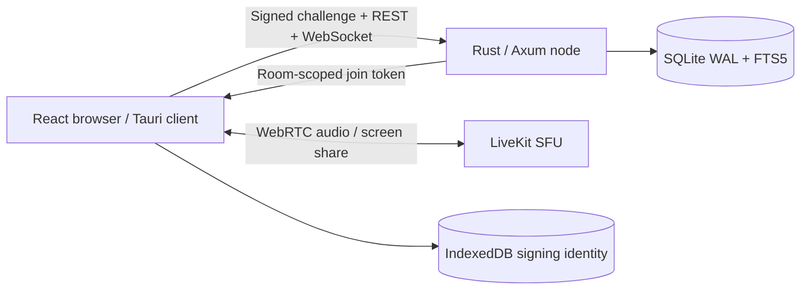

# Architecture

Raeen 0.1 gives each community one authoritative node. A client connects directly to that node for chat and to its configured LiveKit relay for media. Reusing an identity key on two nodes creates separate memberships with the same public key; this is portable identity, not server-to-server federation.

## Client

React 19 and TypeScript, with Vite and TanStack Virtual. History is fetched in pages of 60. In-memory histories are scoped by channel. Drafts stay in memory per channel while the client runs. Accent, density, last channel, and node addresses persist in localStorage. Signing keys are CryptoKey objects in IndexedDB, with exportable private keys to support encrypted backups. No private key is stored in localStorage or sent to a node.

The backup format encrypts a private JWK and display name using AES-256-GCM, a fresh 12-byte IV, and a key derived using PBKDF2-SHA256 with 250,000 iterations and a fresh 16-byte salt. Import validates the key pair with a local signature round trip. Backup passphrases are never persisted. This is a recovery mechanism, not an account service; there is no email-based recovery, device revocation, or automatic cross-device synchronization.

The desktop shell is intentionally thin. It ships the same client in a Tauri webview and does not embed a community server, database, SFU, or native audio processor. The production JavaScript voice SDK is dynamically loaded when joining a configured room.

## Node

Axum/Tokio handles REST and WebSocket connections. SQLx owns a five-connection SQLite pool with WAL mode, foreign keys, and a busy timeout. A persisted UUID identifies the node. Schema creation is idempotent for this initial version; a migration/versioning framework is required before evolving deployed schemas.

The five default channels are inserted with stable IDs. Messages use a UUID for public identity and a monotonically increasing SQLite sequence for pagination. A unique `(user_id, client_id)` constraint prevents duplicated messages on a send retry. Every role-sensitive request reloads the user from SQLite, so role revocation affects existing HTTP sessions immediately.

In-memory broadcast channels deliver events. Lagged WebSocket consumers receive `resync`. There is no durable event cursor. Reconnect authenticates again and fetches the current membership, channels, and active-channel history. Presence counts connections per identity so closing one tab does not mark another tab offline.

The first registration computes owner assignment in the insert statement under SQLite’s write lock. `RAEEN_OWNER_KEY`, if set before registration, reserves ownership for that key. Other people become members even if they arrive first. Owners cannot be demoted through the current API.

Search is node-side FTS5. Parameterized queries and quoted search terms prevent SQL injection and arbitrary FTS query syntax. Triggers maintain the index on inserts, edits, and deletions. Text, identities, membership, and message metadata are visible to the node operator.

## Voice

The node signs a standard LiveKit HS256 access token after authenticating the caller and verifying that the channel is a voice channel. Tokens identify the participant and authorize one node/channel room. The browser then connects directly to LiveKit. Server API secrets never reach the client. The integration does not enable content E2EE; WebRTC transport encryption terminates at the SFU.

The client requests a microphone only when joining. Remote audio is attached outside the channel view, so it continues while reading text channels. Screen tracks are attached in the active voice view. LiveKit owns media transport reconnection. Native noise suppression, push-to-talk, per-app capture, audio routing, and platform-specific loopback remain unimplemented.

A local two-browser call was verified against LiveKit 1.13.11 using Chromium's synthetic microphone devices. Both clients decoded remote audio, and mute, deafen, disconnect, and audio continuity during text-channel navigation passed. This does not validate real hardware, WAN latency, native screen capture, or cross-platform behavior.

## Boundaries and limitations

- HTTPS/WSS is required for remote connections. Loopback HTTP is allowed for local development. The node itself expects TLS termination at a reverse proxy.
- Bearer sessions are random, in memory, valid for seven days, and expire on restart. The client silently proves its local identity again to recover. WebSocket tokens are sent in the first frame, never in URLs.
- Auth challenges are bounded, expire after 60 seconds, and are consumed before signature verification. Their signed message binds the node ID and public key. The client checks the signing envelope before signing.
- No stable node-key pinning, multi-device revocation, or formal protocol security review has been performed. A malicious node still controls its own data, membership, and availability.
- All channels share the node’s membership boundary. Role bits control capabilities; they are not per-channel privacy or deny-overwrite rules.
- The app has small per-IP authentication limits and per-user mutation limits. It has no ban lists, invitation policy, robust distributed abuse control, or reverse-proxy IP trust configuration.
- Message rendering treats text as text; no raw HTML or remote embeds execute. Native capabilities are not exposed to untrusted chat content. Fonts are bundled. The built server and desktop app include a Content Security Policy.
- Local browser storage is not an encrypted vault. Device compromise or a same-origin script exploit can access a signing identity. An encrypted backup protects the downloaded file, not a running compromised client.
- SQLite data and search indexes are plaintext at rest. E2EE and local encrypted search must be designed together, including device sync, key recovery, history, attachments, bridges, and moderation.
- Messages have a 4,000-character limit; HTTP bodies are limited to 32 KiB. Attachments, direct messages, threads, video camera publishing, bridges, and federation are outside 0.1.
- No performance or hosting-cost claims have been validated. Measure end-to-end resource use, including the webview processes and voice relay, before publishing comparisons.

## Delivery sequence

1. Validate chat and voice with a small, trusted community and collect resource measurements.
2. Add invite-only registration, bans, quotas, backups, schema migrations, and an operational deployment guide.
3. Define and review device identity, revocation, recovery, and key distribution; integrate an existing E2EE protocol/library.
4. Build a local encrypted cache and search index with explicit retention semantics.
5. Stabilize the client/node protocol, then design cross-node identity discovery and authenticated membership/delivery. Cryptographic signatures alone do not provide federation.
